<p align="center">
  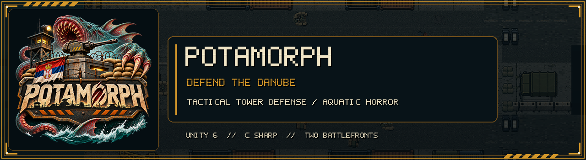
</p>

**POTAMORPH** is a single-player, top-down tower defense game set along a post-nuclear Danube quarantine line. Build and upgrade fortifications, manage an RSD-based economy, survive escalating aquatic assaults, and develop permanent research upgrades across two distinct battlefields.

**Unity 6.3 LTS · C# · URP 2D · UI Toolkit · Two maps · Endless waves · Phase 6E**

[Gameplay](#hold-the-river) · [Architecture](#inside-the-defense-line) · [Built with Codex](#built-with-codex) · [Run locally](#open-the-project)

<a id="hold-the-river"></a>
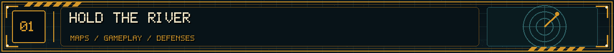

The water is on the left. The line you are defending is on the right. Creatures emerge through disturbed water or arrive in organic cysts and living brood carriers, then follow weighted grid routes inland. Every breach increases the run's **Homicides** counter; the configured threshold ends the run.

Without research bonuses, each new run begins with **500 RSD**. Choose your defenses during Preparation, press **START WAVE**, and reinvest kill rewards and wave grants in new structures, upgrades and repairs. Permanent research can modify the starting budget and other run statistics.

<p align="center">
  <a href="Docs/Validation/Phase6E/encounter-25-CoastalDefense_TopDown.png">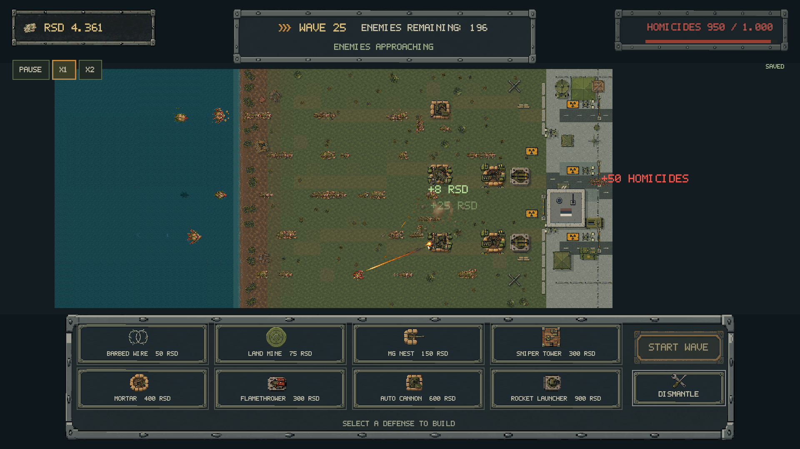</a>
</p>

_Phase 6E encounter validation capture. This is test evidence, not a claim of a naturally earned, unassisted run._

### Two different front lines

<p align="center">
  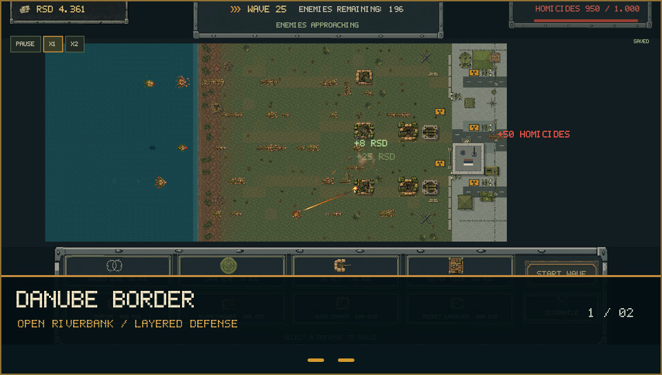
</p>

Both maps use the same placement, economy, combat, wave, and save systems. The port adds authored blocked terrain, eight berths, sixteen unloading positions, and two inland breach zones through map data and scene context.

<details>
<summary><b>More aquatic encounter captures (Phase 6E)</b></summary>

<a href="Docs/Validation/Phase6E/boss-Broodmother-specialized-DanubeIndustrialPort.png">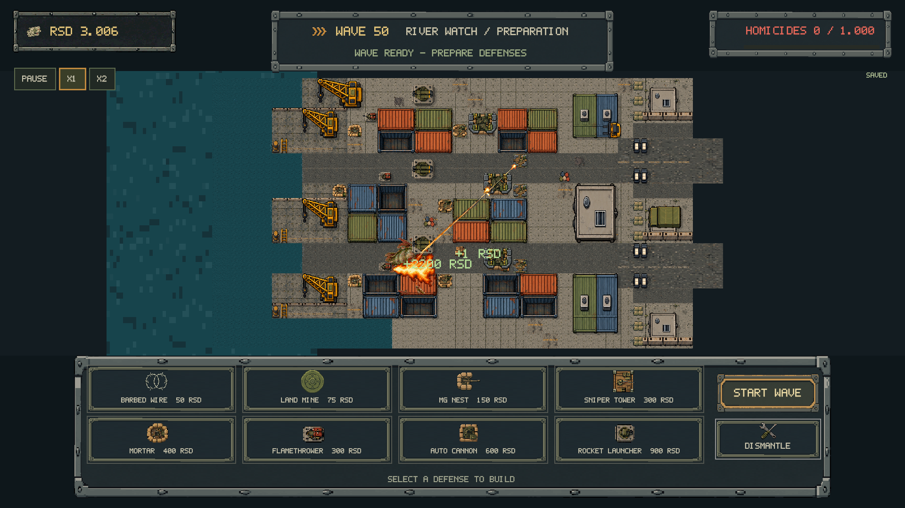</a>

<a href="Docs/Validation/Phase6E/boss-Dredger-specialized-CoastalDefense_TopDown.png">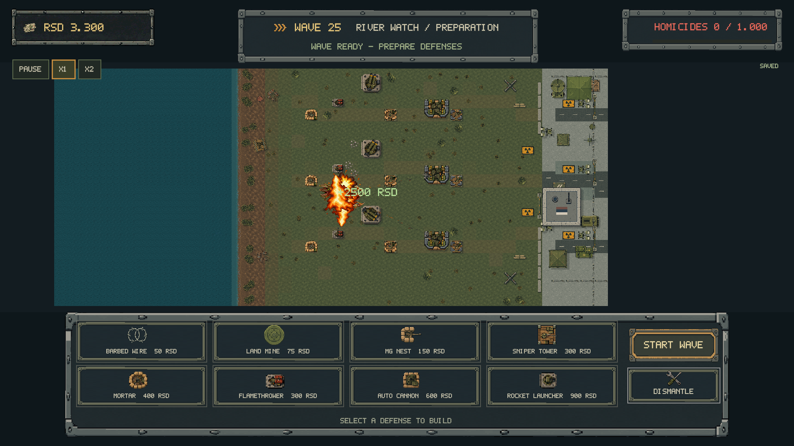</a>

_Controlled test captures; they may use configured encounter scenarios rather than ordinary run progression._

</details>

### Eight defenses, one construction system

| Defense         |    Cost | Role                                                  |
| --------------- | ------: | ----------------------------------------------------- |
| Barbed Wire     |  50 RSD | Slow enemies and shape the time they spend under fire |
| Land Mine       |  75 RSD | A single-use proximity explosion                      |
| MG Nest         | 150 RSD | Sustained automatic fire                              |
| Sniper Tower    | 300 RSD | Long-range hitscan fire                               |
| Mortar          | 400 RSD | Area fire with a minimum firing distance              |
| Flamethrower    | 300 RSD | Close-range fire and burning damage                   |
| Auto Cannon     | 600 RSD | Heavy direct fire with partial armor bypass           |
| Rocket Launcher | 900 RSD | Explosive attacks against groups                      |

Structures share placement, occupancy, affordability, selection, and Level II/III upgrades. Repairs and dismantling use explicit transactions. Wire connections update their neighboring presentation without owning navigation or money.

The endless system combines seeded wave generation, a pressure director, enemy transport capacity, special encounters, and **13 events**. Fog, Flooded Shore, supply drops, and sector assaults change the next decision. The Dredger and Broodmother use the shared emergence, registry and breach flow. Spitters damage nearby defenses; visible Burrowers briefly bypass wire slowdown; Broodmother offspring are bounded and counted in the active wave.

### Persistent research and first-run guidance

Between runs, spend earned **Research Points (RP)** on a persistent **20-node tech tree** across Logistics, Engineering, Weapons and Intelligence. The four branches contain **610 RP** of research in total. New runs use the unlocked effects; a saved run continues with its original research snapshot.

<p align="center">
  <a href="Docs/Validation/Phase6E/research-tree-1920x1080.png">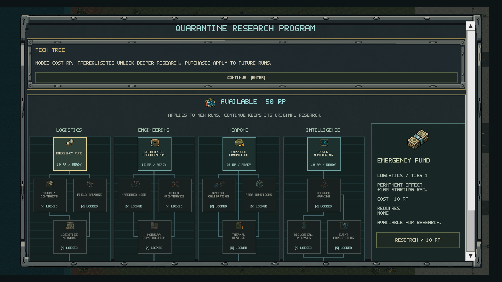</a>
</p>

A contextual tutorial introduces construction, enemy types, repairs, upgrades, events, bosses and research using ordinary gameplay and menu screens. Guidance can be skipped or disabled without altering combat rules.

<details>
<summary><b>HUD and tutorial validation captures</b></summary>

<a href="Docs/Validation/Phase6E/repair-1920x1080.png">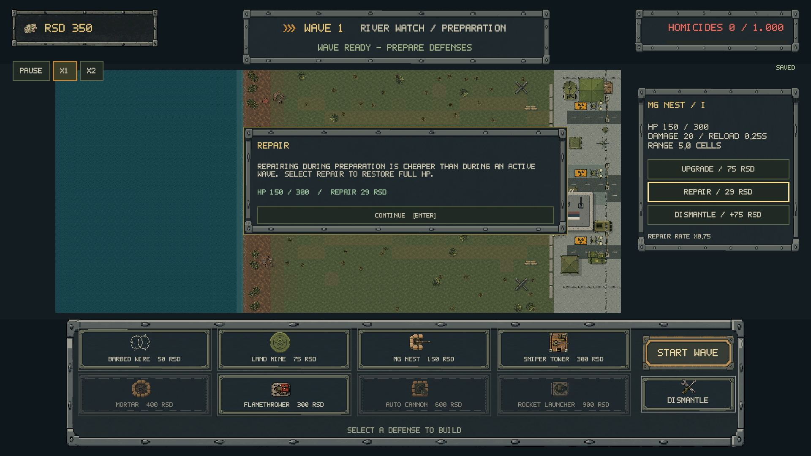</a>

<a href="Docs/Validation/Phase6E/intro-1920x1080.png">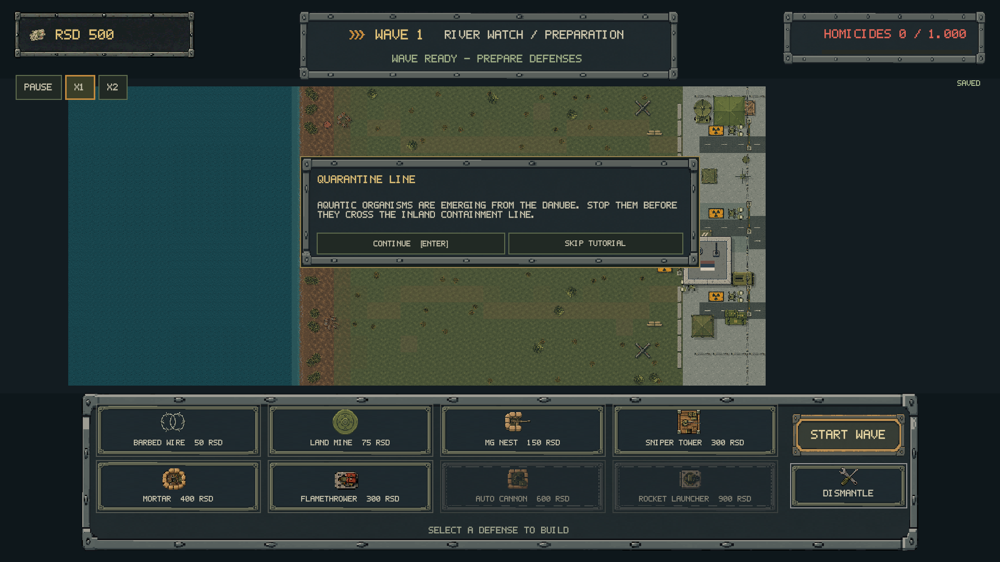</a>

_UI captures come from validation fixtures; they are not presented as independent human playtest evidence._

</details>

<a id="inside-the-defense-line"></a>
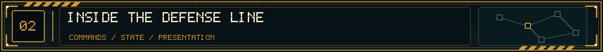

The game keeps configuration, gameplay state, and presentation in separate owners. UI sends commands and observes committed changes. Prices, health, footprints, wave tuning, events, and map identities come from **ScriptableObjects**.

### Construction and combat

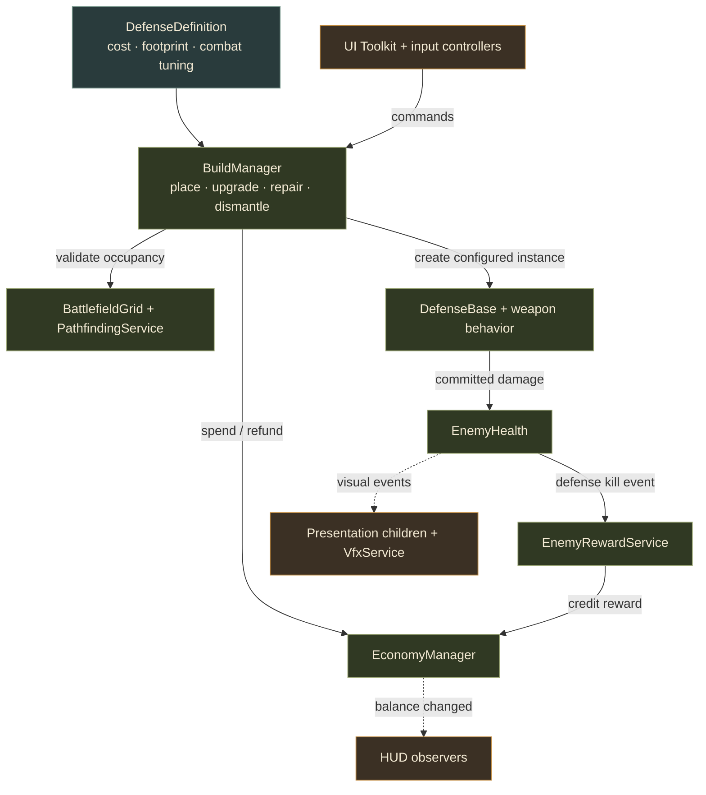

`EconomyManager` owns currency. `BuildManager` owns construction and management transactions. `DefenseBase` owns each built structure's state; weapon components perform combat. Build occupancy and navigation changes have separate notifications, and blocking placement requires route validation.

### From a wave plan to a border breach

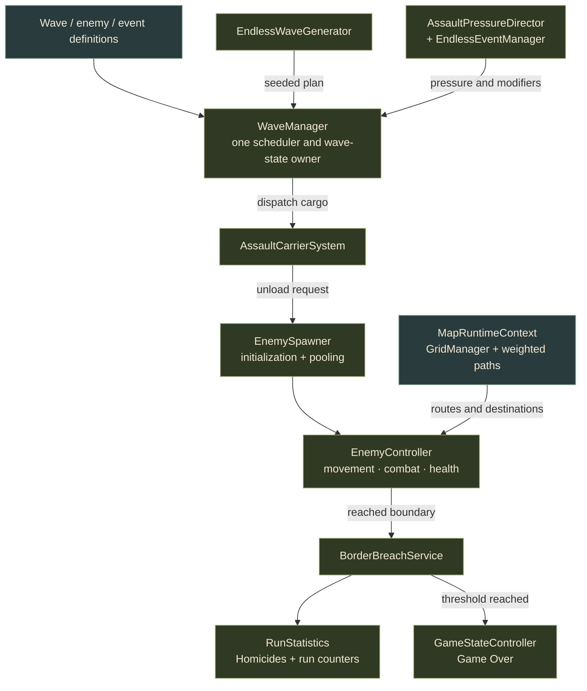

The director and event manager are policy objects held by `WaveManager`. `MapDefinition` and `MapCatalog` select a scene and its battlefield data. The scene-owned `MapRuntimeContext` binds landing sectors, routes, and breach destinations. Both maps reuse the same gameplay services.

Saves happen during **Preparation**. `RunSession` gathers a stable snapshot from the existing owners; `SaveGameService` validates version and map compatibility; `LocalJsonStore` writes through a flushed temporary file and atomic replacement. Continue restores the saved map, structures, levels, HP, money, seed, event state and research snapshot. Leaving during combat returns to the last Preparation checkpoint.

Permanent research and RP are managed separately from individual run checkpoints. Tutorial progress, settings and run history also have their own persisted state, so a new run does not erase account-level progression or completed guidance.

<details>
<summary><b>Source map</b></summary>

| Responsibility                         | Source                                                                            |
| -------------------------------------- | --------------------------------------------------------------------------------- |
| Placement and management commands      | [Building](Assets/Game/Scripts/Building/)                                         |
| Structure state and weapon behavior    | [Defenses](Assets/Game/Scripts/Defenses/)                                         |
| Currency and kill rewards              | [Economy](Assets/Game/Scripts/Economy/)                                           |
| Grids, routes and map context          | [Grid](Assets/Game/Scripts/Grid/)                                                 |
| Enemy initialization and lifecycle     | [Enemies](Assets/Game/Scripts/Enemies/)                                           |
| Waves, transports, pressure and events | [Waves](Assets/Game/Scripts/Waves/)                                               |
| Checkpoints, settings and history      | [Persistence](Assets/Game/Scripts/Persistence/)                                   |
| Persistent research and RP             | [Progression](Assets/Game/Scripts/Progression/)                                   |
| Contextual first-run guidance          | [Tutorial](Assets/Game/Scripts/Tutorial/)                                         |
| Sprite/VFX observers and UI Toolkit    | [Presentation](Assets/Game/Scripts/Presentation/) · [UI](Assets/Game/Scripts/UI/) |
| Tunable definitions                    | [Game data](Assets/Game/Data/)                                                    |

Gameplay is strictly **XY**: X horizontal, Y vertical, Z for presentation depth. Sorting runs Environment → GroundObjects → Enemies → Defenses → Effects. Visuals sit below gameplay roots; sprite animation does not apply damage or control movement.

</details>

<a id="built-with-codex"></a>
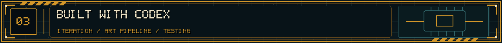

Development followed bounded phase briefs. The game owner chose the direction and next scope; Codex inspected the existing project, implemented C# systems, authored Unity tooling, ran validation, and recorded the results. The repository retains the phase reports, authoring scripts, art batches, prompts, revisions, and test evidence behind that work.

### The development record

| Phase     | What it established                                                                                   | Record                                                                                                                                   |
| --------- | ----------------------------------------------------------------------------------------------------- | ---------------------------------------------------------------------------------------------------------------------------------------- |
| 1 → 2A    | Playable foundation, grid/pathfinding, then the move from the original XZ scene to strict overhead XY | [Foundation](PHASE_1_STEP_1_REPORT.md) · [XY conversion](PHASE_2A_REPORT.md)                                                             |
| 2B → 2C   | Shared placement/economy, four initial defenses, and player-started finite waves                      | [Placement](PHASE_2B_REPORT.md) · [Defense loop](PHASE_2C_REPORT.md)                                                                     |
| 3A1 → 3A3 | Approved visual master, environment/UI foundation, core enemy and defense exports                     | [Master](PHASE_3A1_REPORT.md) · [Enemies](PHASE_3A2_REPORT.md) · [Defenses](PHASE_3A3_REPORT.md)                                         |
| 3B → 3C.1 | Bounded combat VFX, world/HUD integration, connected wire, and river landings                         | [VFX](PHASE_3B_REPORT.md) · [Integration](PHASE_3C_REPORT.md) · [River polish](PHASE_3C1_REPORT.md)                                      |
| 4A → 4D   | Endless survival, RSD, heavy weapons, special encounters, and assault pressure                        | [Survival](PHASE_4A_REPORT.md) · [Heavy weapons](PHASE_4B_REPORT.md) · [Encounters](PHASE_4C_REPORT.md) · [Pressure](PHASE_4D_REPORT.md) |
| 5A → 5B   | Structure inspection, Level II/III upgrades, repairs, game speed, and thirteen events                 | [Management](PHASE_5A_REPORT.md) · [Events](PHASE_5B_REPORT.md)                                                                          |
| 5C        | Main menu, Preparation checkpoints, Continue, settings, and run history                               | [Product flow](PHASE_5C_REPORT.md)                                                                                                       |
| 6A        | Map selection and Danube Industrial Port through reusable map data and shared services                | [Second map](PHASE_6A_REPORT.md)                                                                                                         |
| 6B        | Original aquatic creatures, organic arrivals, biological bosses and safe save/event migration         | [Aquatic overhaul](PHASE_6B_REPORT.md)                                                                                                   |
| 6C        | Persistent RP progression and a four-branch research tree                                             | [Meta progression](PHASE_6C_REPORT.md)                                                                                                   |
| 6D        | Context-aware first-run tutorial, onboarding and guidance persistence                                 | [Tutorial](PHASE_6D_TUTORIAL_REPORT.md)                                                                                                  |
| 6E        | Economy, enemy/defense balance, wave pacing and long-run validation                                   | [Balance and polish](PHASE_6E_REPORT.md)                                                                                                 |

These reports preserve their original status and limitations. For example, Phase 4C records an unavailable requested boss-art batch and its visual fallback. The playable implementation and the art delivery status are recorded separately.

### An art handbook before an art batch

<a href="Assets/Game/Art/MasterReferences/ref_aquatic_enemy_lineup_01.png">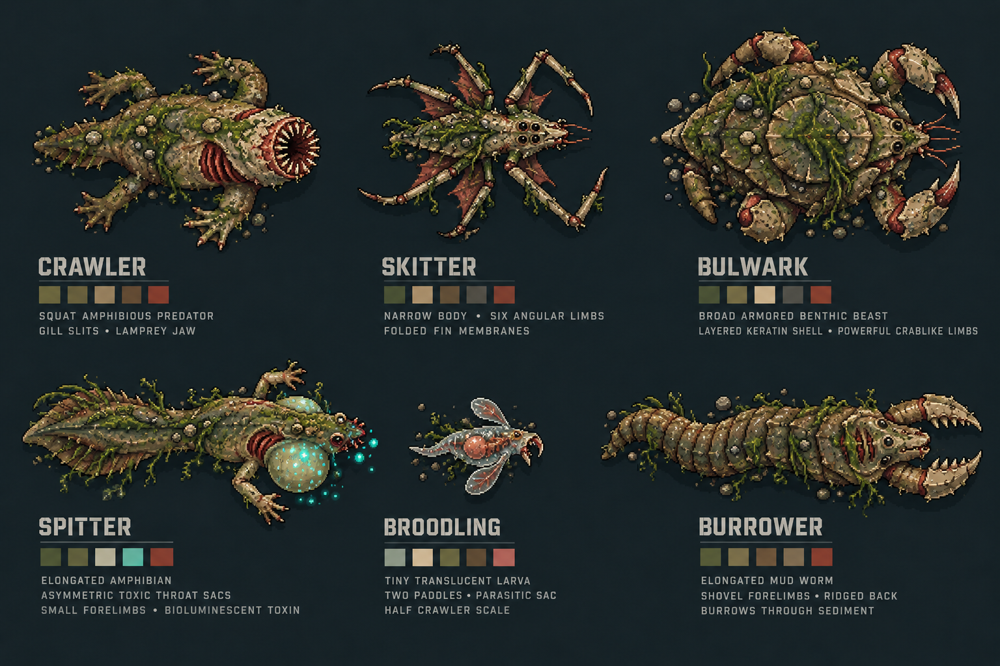</a>

_Phase 6B creature reference, selected by the executing agent under the autonomous brief. This is a design board, not a gameplay screenshot or independent human approval._

The [art handbook](ART_HANDBOOK.md) fixes the overhead perspective, material language, palette, scale, silhouettes, and readable UI. The [lore handbook](LORE_HANDBOOK.md) establishes the alternate post-nuclear Balkan setting. The selected master revision anchors later batches.

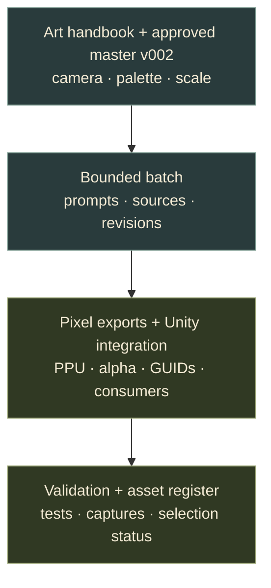

Codex used recorded ImageGen batches for artwork, followed by the documented export and integration process. World exports use **51.2 PPU**, Point filtering, hard alpha where appropriate, and preserved GUIDs. Batch records retain exact prompts, references, rejected revisions, selection authority, import settings, and consuming assets. See the [asset register](Docs/Art/ASSET_REGISTER.md) and [batch records](Docs/Art/Batches/).

### Project rules and custom skills

| Guide                                                                                                         | What it keeps consistent                                                                                          |
| ------------------------------------------------------------------------------------------------------------- | ----------------------------------------------------------------------------------------------------------------- |
| [AGENTS.md](AGENTS.md)                                                                                        | XY conventions, architecture ownership, placement/navigation rules, inspection and validation                     |
| [game-art-pipeline-engineering](.agents/skills/game-art-pipeline-engineering/SKILL.md)                        | Bounded art batches, reference reuse, provenance, sprite/prefab integration, and preservation of working gameplay |
| [unity-pipeline](.agents/skills/unity-pipeline/SKILL.md)                                                      | Driving a live Unity instance, recompilation, test execution, and versioned authoring scripts                     |
| [Art production rules](ART_PRODUCTION_RULES.md) · [Unity integration contract](Docs/Art/UNITY_INTEGRATION.md) | Source/runtime separation, pixel density, pivots, alpha, sorting, and presentation ownership                      |

The engineering workflow also used the local `game-software-engineering` and `unity-cli` skills. The two project-scoped skills above are versioned in this repository. The README's POTAMORPH banners are now generated by [`build_media.py`](Docs/Readme/Tools/build_media.py) from the supplied logo, project font and artwork; earlier capture and SVG-generation history remains documented in [README media notes](Docs/Readme/MEDIA.md).

<a id="open-the-project"></a>
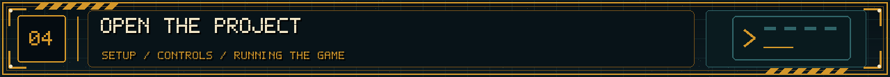

1. Install **Unity 6000.3.24f1 (6.3 LTS)** with an activated license.
2. Open this repository as a Unity project and let Package Manager restore the pinned dependencies.
3. Open [`MainMenu.unity`](Assets/Game/Scenes/MainMenu.unity) and press **Play**.
4. Choose **NEW GAME**, select a map, and press **START**. Build during Preparation, then start the wave.

The saved scenes, prefabs, data, art, animations, and UI are included. The build starts at MainMenu. Normal play uses the saved content directly.

| Action                         | Input                                                                   |
| ------------------------------ | ----------------------------------------------------------------------- |
| Select a defense               | Build button or **1–8**, following the displayed order                  |
| Place / inspect a structure    | **Left mouse button**                                                   |
| Cancel placement or selection  | **Right mouse button** or **Escape**                                    |
| Pause / resume                 | **Space**; **Escape** follows the current selection/dialog/menu context |
| Dismantle a selected structure | **Delete**, then confirm the displayed refund                           |
| Change simulation speed        | HUD **×1 / ×2** controls                                                |

<details>
<summary><b>Scene paths, tuning and authoring notes</b></summary>

| Scene                                               | Purpose                            |
| --------------------------------------------------- | ---------------------------------- |
| `Assets/Game/Scenes/MainMenu.unity`                 | Product entry point                |
| `Assets/Game/Scenes/CoastalDefense_TopDown.unity`   | Danube Border                      |
| `Assets/Game/Scenes/DanubeIndustrialPort.unity`     | Industrial Port                    |
| `Assets/Game/Scenes/CoastalDefense_Prototype.unity` | Historical XZ regression reference |

Tune definitions under [`Assets/Game/Data/`](Assets/Game/Data/). Local saves live under `Application.persistentDataPath/BorderDefenders`.

Scene rebuild helpers under **Tools → Shoreline Defense** replace authored layout or overrides. Use them for intentional scene authoring. Load gameplay scenes individually.

If the Unity CLI cannot find an existing Editor installation, register its executable with `unity editors add "C:/path/to/Editor/Unity.exe"`.

</details>

### Validation and current boundaries

Phase 6E validation on **2026-11-02–03** passed **168/168 EditMode** and **110/110 PlayMode** tests on Unity 6000.3.24f1. The latest phase covers defense/enemy balance, economy, wave pacing, research persistence, encounters, both maps and regression testing. See the [Phase 6E report](PHASE_6E_REPORT.md) for the test fixtures, actual outcomes and remaining limitations.

Run both test assemblies in **Window → General → Test Runner**, or use the Unity CLI with the Editor closed:

```powershell
unity test . --editor-version 6000.3.24f1 --mode EditMode --output TestResults/editmode.xml
unity test . --editor-version 6000.3.24f1 --mode PlayMode --output TestResults/playmode.xml
```

Phase 6E produced a successful Windows release build at `Builds/Phase6E/BorderDefenders.exe` (the executable retains its historical internal name). The game remains a playable prototype. The report distinguishes actual gameplay from scripted fixtures and does not claim a completed independent human balance review or multi-hour standalone performance certification. Production audio is still deferred; see [audio status](AUDIO_LICENSES.md).

[MIT license](LICENSE) · [Project rules](AGENTS.md) · [Latest phase report](PHASE_6E_REPORT.md) · [Art register](Docs/Art/ASSET_REGISTER.md)
