<p align="center">
  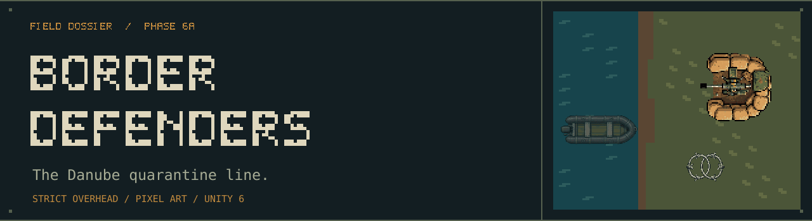
</p>

# Border Defenders

Hold a post-nuclear Danube quarantine line against infected river landings. Build a defense network, spend earned RSD on repairs and upgrades, and survive increasingly crowded assaults across an open river border and an abandoned industrial port.

**Unity 6.3 LTS · C# · URP 2D · UI Toolkit · Single-player prototype · Phase 6A**

[Gameplay](#hold-the-river) · [Architecture](#inside-the-defense-line) · [Built with Codex](#built-with-codex) · [Run locally](#open-the-project)

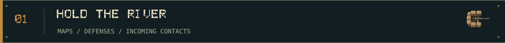

## Hold the river

The water is on the left. The line you are defending is on the right. Enemies arrive in boats, unload at the shore, and follow weighted grid routes inland. Every breach increases the run's **Homicides** counter; the configured threshold ends the run.

Start with **500 RSD**, choose your first positions, then press **START WAVE**. Kill rewards and wave bonuses pay for the next construction, repair, or upgrade. Between waves, inspect the next assault and decide where the money will do the most work.

<picture>
  <source media="(prefers-reduced-motion: reduce)" srcset="Docs/Readme/Media/danube-border-poster.png">
  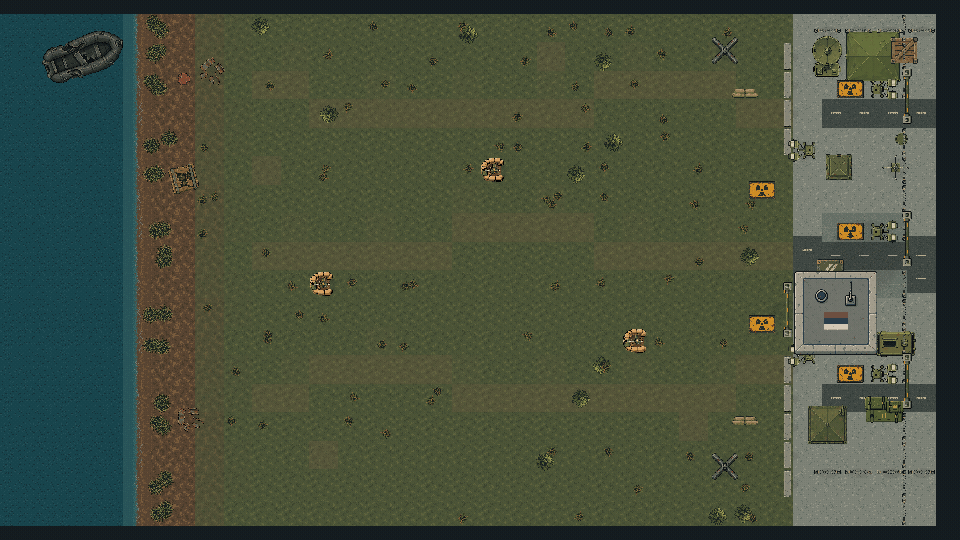
</picture>

*Recorded in Unity: 12 seconds at 10 fps, normal 500 RSD start and three scripted MG placements. This is a world-camera capture; the UI is shown below. Static posters are available when reduced motion is requested.*

### Two different front lines

<table>
  <tr>
    <td width="50%">
      <a href="Docs/Readme/Media/danube-border.png">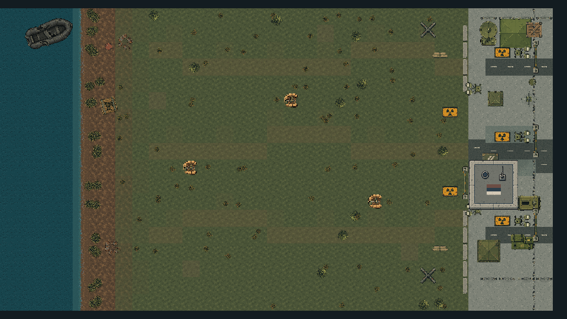</a>
      <br><b>DANUBE BORDER</b><br>
      Broad building space, a long riverbank, and room to spread overlapping fire.
    </td>
    <td width="50%">
      <a href="Docs/Readme/Media/industrial-port.png"></a>
      <br><b>DANUBE INDUSTRIAL PORT</b><br>
      Projecting docks, container yards, split routes, and cleared concrete pockets.
    </td>
  </tr>
</table>

Both maps use the same placement, economy, combat, wave, and save systems. The port adds authored blocked terrain, eight berths, sixteen unloading positions, and two inland breach zones through map data and scene context.

<details>
<summary><b>Watch the Industrial Port landing sequence</b></summary>

<picture>
  <source media="(prefers-reduced-motion: reduce)" srcset="Docs/Readme/Media/industrial-port-poster.png">
  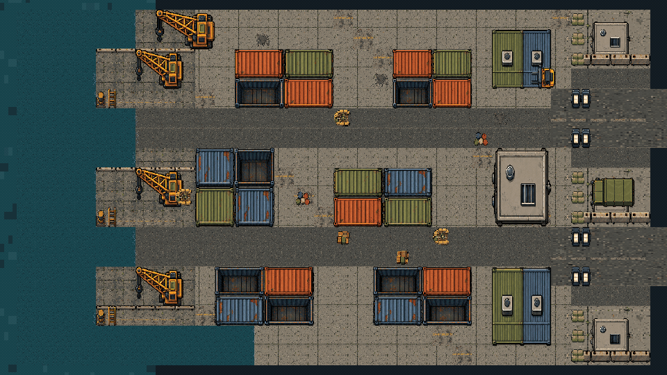
</picture>

*Another 12-second engine capture, using the same 500 RSD budget. Placement is scripted through the ordinary BuildManager API. These clips illustrate the systems; they are not human balance certification.*

</details>

### Eight defenses, one construction system

| Defense | Cost | Role |
| --- | ---: | --- |
| Barbed Wire | 50 RSD | Slow enemies and shape the time they spend under fire |
| Land Mine | 75 RSD | A single-use proximity explosion |
| MG Nest | 150 RSD | Sustained automatic fire |
| Sniper Tower | 300 RSD | Long-range hitscan fire |
| Mortar | 400 RSD | Area fire with a minimum firing distance |
| Flamethrower | 300 RSD | Close-range fire and burning damage |
| Auto Cannon | 600 RSD | Heavy direct fire with area impact |
| Rocket Launcher | 900 RSD | Explosive attacks against groups |

Structures share placement, occupancy, affordability, selection, and Level II/III upgrades. Repairs and dismantling use explicit transactions. Wire connections update their neighboring presentation without owning navigation or money.

The endless system combines seeded wave generation, a pressure director, enemy transport capacity, special encounters, and **13 events**. Fog, Flooded Shore, supply drops, and sector assaults change the next decision. Boss transports use the existing landing and breach flow.

<details>
<summary><b>HUD, structure management and encounter screenshots</b></summary>

<a href="Docs/Validation/Phase5C/hud-1080.png">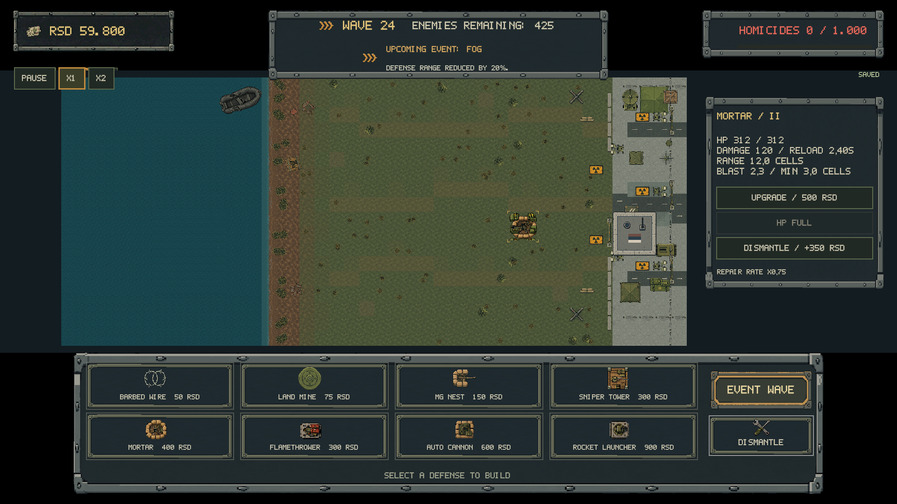</a>

*UI Toolkit: live currency and wave counters, structure inspection, upgrade/repair actions, and event information.*

<a href="Docs/Validation/Phase6A/boss-encounter-hud.png">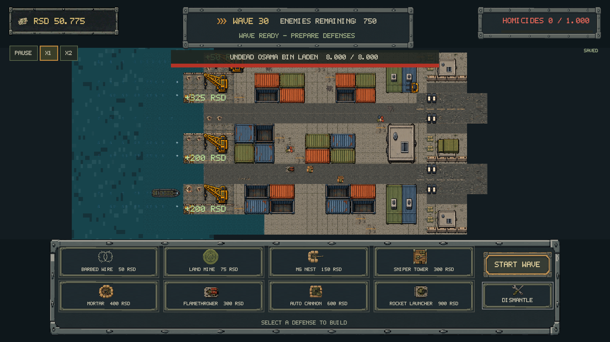</a>

*Historical QA captures include setup budgets and wave jumps. The normal starting balance is 500 RSD.*

</details>

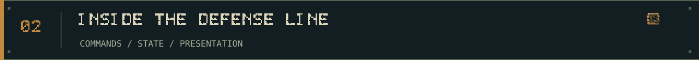

## Inside the defense line

The game keeps configuration, gameplay state, and presentation in separate owners. UI sends commands and observes committed changes. Prices, health, footprints, wave tuning, events, and map identities come from **ScriptableObjects**.

### Construction and combat

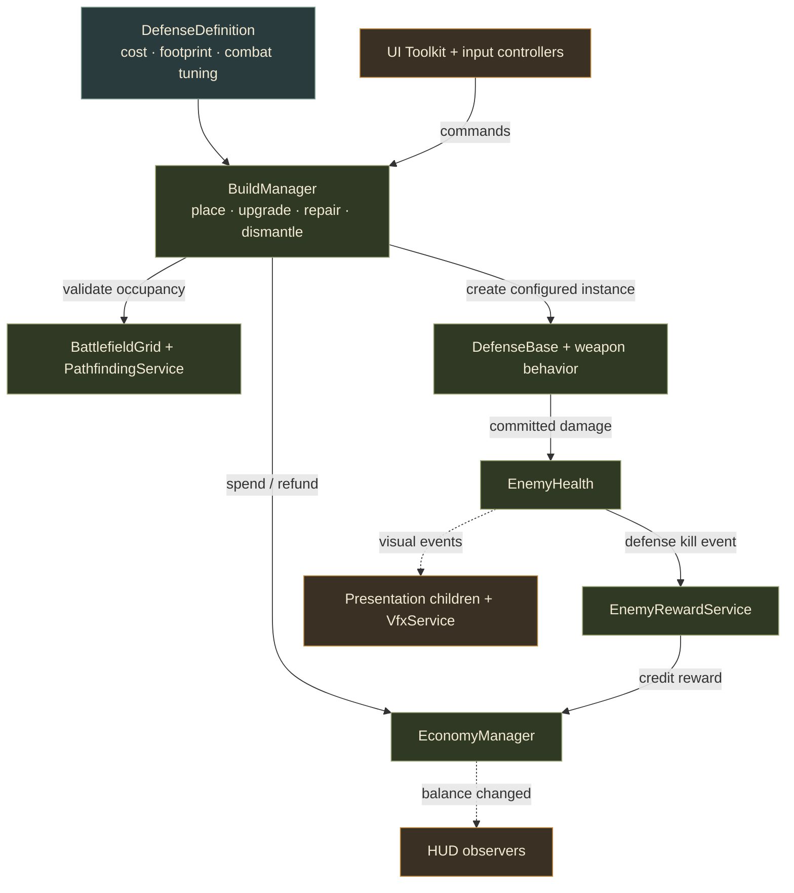

`EconomyManager` owns currency. `BuildManager` owns construction and management transactions. `DefenseBase` owns each built structure's state; weapon components perform combat. Build occupancy and navigation changes have separate notifications, and blocking placement requires route validation.

### From a wave plan to a border breach

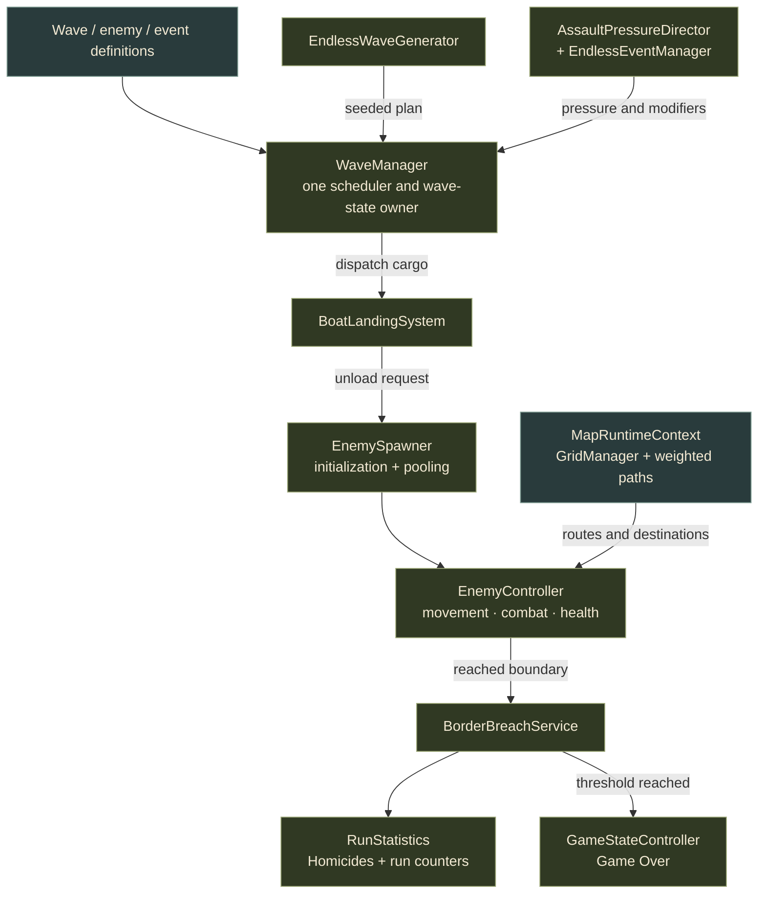

The director and event manager are policy objects held by `WaveManager`. `MapDefinition` and `MapCatalog` select a scene and its battlefield data. The scene-owned `MapRuntimeContext` binds landing sectors, routes, and breach destinations. Both maps reuse the same gameplay services.

Saves happen during **Preparation**. `RunSession` gathers a stable snapshot from the existing owners; `SaveGameService` validates the version and map compatibility; `LocalJsonStore` writes through a flushed temporary file and atomic replacement. Continue restores the saved map, structures, levels, HP, money, seed, and event state. Leaving during combat returns to the last Preparation checkpoint. Settings and run history use independent files.

<details>
<summary><b>Source map</b></summary>

| Responsibility | Source |
| --- | --- |
| Placement and management commands | [Building](Assets/Game/Scripts/Building/) |
| Structure state and weapon behavior | [Defenses](Assets/Game/Scripts/Defenses/) |
| Currency and kill rewards | [Economy](Assets/Game/Scripts/Economy/) |
| Grids, routes and map context | [Grid](Assets/Game/Scripts/Grid/) |
| Enemy initialization and lifecycle | [Enemies](Assets/Game/Scripts/Enemies/) |
| Waves, transports, pressure and events | [Waves](Assets/Game/Scripts/Waves/) |
| Checkpoints, settings and history | [Persistence](Assets/Game/Scripts/Persistence/) |
| Sprite/VFX observers and UI Toolkit | [Presentation](Assets/Game/Scripts/Presentation/) · [UI](Assets/Game/Scripts/UI/) |
| Tunable definitions | [Game data](Assets/Game/Data/) |

Gameplay is strictly **XY**: X horizontal, Y vertical, Z for presentation depth. Sorting runs Environment → GroundObjects → Enemies → Defenses → Effects. Visuals sit below gameplay roots; sprite animation does not apply damage or control movement.

</details>

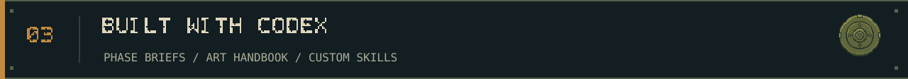

## Built with Codex

Development followed bounded phase briefs. The game owner chose the direction and next scope; Codex inspected the existing project, implemented C# systems, authored Unity tooling, ran validation, and recorded the results. The repository retains the phase reports, authoring scripts, art batches, prompts, revisions, and test evidence behind that work.

### The development record

| Phase | What it established | Record |
| --- | --- | --- |
| 1 → 2A | Playable foundation, grid/pathfinding, then the move from the original XZ scene to strict overhead XY | [Foundation](PHASE_1_STEP_1_REPORT.md) · [XY conversion](PHASE_2A_REPORT.md) |
| 2B → 2C | Shared placement/economy, four initial defenses, and player-started finite waves | [Placement](PHASE_2B_REPORT.md) · [Defense loop](PHASE_2C_REPORT.md) |
| 3A1 → 3A3 | Approved visual master, environment/UI foundation, core enemy and defense exports | [Master](PHASE_3A1_REPORT.md) · [Enemies](PHASE_3A2_REPORT.md) · [Defenses](PHASE_3A3_REPORT.md) |
| 3B → 3C.1 | Bounded combat VFX, world/HUD integration, connected wire, and river landings | [VFX](PHASE_3B_REPORT.md) · [Integration](PHASE_3C_REPORT.md) · [River polish](PHASE_3C1_REPORT.md) |
| 4A → 4D | Endless survival, RSD, heavy weapons, special encounters, and assault pressure | [Survival](PHASE_4A_REPORT.md) · [Heavy weapons](PHASE_4B_REPORT.md) · [Encounters](PHASE_4C_REPORT.md) · [Pressure](PHASE_4D_REPORT.md) |
| 5A → 5B | Structure inspection, Level II/III upgrades, repairs, game speed, and thirteen events | [Management](PHASE_5A_REPORT.md) · [Events](PHASE_5B_REPORT.md) |
| 5C | Main menu, Preparation checkpoints, Continue, settings, and run history | [Product flow](PHASE_5C_REPORT.md) |
| 6A | Map selection and Danube Industrial Port through reusable map data and shared services | [Second map](PHASE_6A_REPORT.md) |

These reports preserve their original status and limitations. For example, Phase 4C records an unavailable requested boss-art batch and its visual fallback. The playable implementation and the art delivery status are recorded separately.

### An art bible before an art batch

<a href="Assets/Game/Art/MasterReferences/bd_ref_danube_master_v002.png">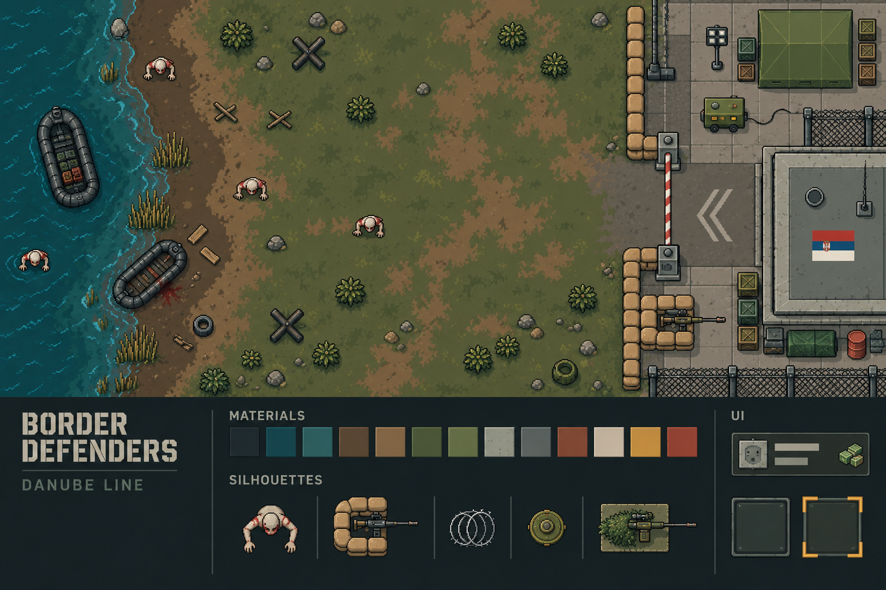</a>

*The approved visual master, v002. This is the art-direction board, not a gameplay screenshot.*

The [art bible](ART_BIBLE.md) fixes the overhead perspective, material language, palette, scale, silhouettes, and readable UI. The [lore bible](LORE_BIBLE.md) establishes the alternate post-nuclear Balkan setting. The selected master revision anchors later batches.

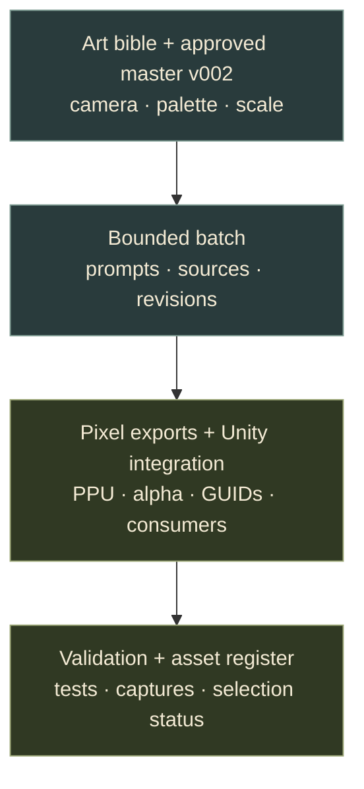

Codex used recorded ImageGen batches for artwork, followed by the documented export and integration process. World exports use **51.2 PPU**, Point filtering, hard alpha where appropriate, and preserved GUIDs. Batch records retain exact prompts, references, rejected revisions, selection authority, import settings, and consuming assets. See the [asset register](Docs/Art/ASSET_REGISTER.md) and [batch records](Docs/Art/Batches/).

### Project rules and custom skills

| Guide | What it keeps consistent |
| --- | --- |
| [AGENTS.md](AGENTS.md) | XY conventions, architecture ownership, placement/navigation rules, inspection and validation |
| [game-art-pipeline-engineering](.agents/skills/game-art-pipeline-engineering/SKILL.md) | Bounded art batches, reference reuse, provenance, sprite/prefab integration, and preservation of working gameplay |
| [unity-pipeline](.agents/skills/unity-pipeline/SKILL.md) | Driving a live Unity instance, recompilation, test execution, and versioned authoring scripts |
| [Art production rules](ART_PRODUCTION_RULES.md) · [Unity integration contract](Docs/Art/UNITY_INTEGRATION.md) | Source/runtime separation, pixel density, pivots, alpha, sorting, and presentation ownership |

The engineering workflow also used the local `game-software-engineering` and `unity-cli` skills. The two project-scoped skills above are versioned in this repository. This README's layout uses `ui-ux-pro-max` guidance; its graphics reuse the game's HUD font, palette, and existing sprites. [Media provenance and regeneration](Docs/Readme/MEDIA.md) document the new captures and SVGs.

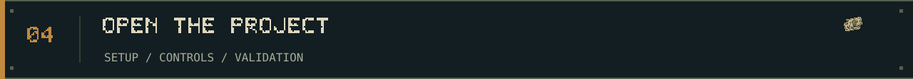

## Open the project

1. Install **Unity 6000.3.24f1 (6.3 LTS)** with an activated license.
2. Open this repository as a Unity project and let Package Manager restore the pinned dependencies.
3. Open [`MainMenu.unity`](Assets/Game/Scenes/MainMenu.unity) and press **Play**.
4. Choose **NEW GAME**, select a map, and press **START**. Build during Preparation, then start the wave.

The saved scenes, prefabs, data, art, animations, and UI are included. The build starts at MainMenu. Normal play uses the saved content directly.

| Action | Input |
| --- | --- |
| Select a defense | Build button or **1–8**, following the displayed order |
| Place / inspect a structure | **Left mouse button** |
| Cancel placement or selection | **Right mouse button** or **Escape** |
| Pause / resume | **Space**; **Escape** follows the current selection/dialog/menu context |
| Dismantle a selected structure | **Delete**, then confirm the displayed refund |
| Change simulation speed | HUD **×1 / ×2** controls |

<details>
<summary><b>Scene paths, tuning and authoring notes</b></summary>

| Scene | Purpose |
| --- | --- |
| `Assets/Game/Scenes/MainMenu.unity` | Product entry point |
| `Assets/Game/Scenes/CoastalDefense_TopDown.unity` | Danube Border |
| `Assets/Game/Scenes/DanubeIndustrialPort.unity` | Industrial Port |
| `Assets/Game/Scenes/CoastalDefense_Prototype.unity` | Historical XZ regression reference |

Tune definitions under [`Assets/Game/Data/`](Assets/Game/Data/). Local saves live under `Application.persistentDataPath/BorderDefenders`.

Scene rebuild helpers under **Tools → Shoreline Defense** replace authored layout or overrides. Use them for intentional scene authoring. Load gameplay scenes individually.

If the Unity CLI cannot find an existing Editor installation, register its executable with `unity editors add "C:/path/to/Editor/Unity.exe"`.

</details>

### Validation and current boundaries

The latest code-cleanup validation, on **2026-10-22**, passed **122/122 EditMode** and **75/75 PlayMode** tests on Unity 6000.3.24f1, with no C# compiler errors or warnings. The [cleanup report](Docs/Validation/ProjectCleanup/report.md) includes the settings regression found and fixed during that run. README media were captured separately; their checks are recorded in the [media notes](Docs/Readme/MEDIA.md).

Run both test assemblies in **Window → General → Test Runner**, or use the Unity CLI with the Editor closed:

```powershell
unity test . --editor-version 6000.3.24f1 --mode EditMode --output TestResults/editmode.xml
unity test . --editor-version 6000.3.24f1 --mode PlayMode --output TestResults/playmode.xml
```

Phase 6A also has a recorded successful Windows release build. This is a playable prototype with generated pixel-art exports. Human comparative balance review, earned-income midgame/boss victories, and sustained standalone profiling remain open validation work. Production audio is still at the pipeline-fixture stage; its status and provenance are in [AUDIO_LICENSES.md](AUDIO_LICENSES.md).

[MIT license](LICENSE) · [Project rules](AGENTS.md) · [Latest phase report](PHASE_6A_REPORT.md) · [Art register](Docs/Art/ASSET_REGISTER.md)
